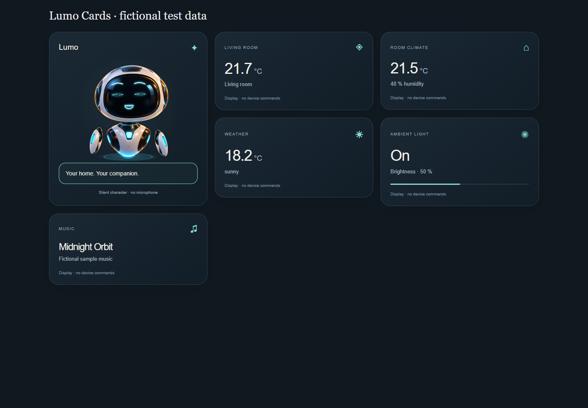

# Lumo Cards for Home Assistant

A floating companion and matching cards for **your own** Home Assistant dashboard. Choose your entities in visual editors; no JavaScript editing required for normal setup.

**0.1.0-beta.2 – early beta, manually tested in a separate real Home Assistant dashboard. Not listed in the default HACS catalog. Code and robot artwork are MIT licensed.**

[Deutsch: Installation](docs/INSTALLATION-DE.md) · [English: installation](docs/INSTALLATION-EN.md) · [TV guide / Fernseher](docs/TV-DE.md) · [English TV guide](docs/TV-EN.md)



[Phone layout with sample data](docs/preview-phone.png)

[Configuration reference](docs/CONFIGURATION.md)

## Two independent building blocks

**Lumo · Companion** works in an existing dashboard or a new one. Configure the name, language, accent color, size, personality, speech bubble, custom greeting and reduced motion. Select any suitable `media_player` to make Lumo dance when it reports playback. A player is optional; the character also works on its own.

**Lumo · Status** displays a sensor, room climate, weather, light or media player in the matching style. Pick the card content first, then your own entity. No family names, local network addresses or household entity IDs are built in.

The cards display state. Tapping a configured status card can open Home Assistant's existing details. They do not issue device commands, play audio, listen to a microphone or make paid AI requests. Text and mouth movements are silent animation.

## Start small or use the whole look

- Add only the robot: `examples/robot-only.yaml`.
- Create a **separate** dashboard: `examples/dashboard-starter.yaml`.
- Reorder cards, choose your own devices and remove anything you do not need.
- Use native HA cards beside Lumo for additional features. Lumo styling is scoped to its own cards; no global theme or main-dashboard replacement.

No Home Assistant token is requested. Data comes from the already signed-in HA frontend. Ordinary HA permissions remain authoritative; hiding a card is not a new access-control mechanism.

## Manual test installation

Copy `dist/lumo-cards.js` into your configuration's `www/lumo/` folder, then add `/local/lumo/lumo-cards.js?v=0.1.0-beta.2` as a JavaScript-module dashboard resource. Reload HA in the browser. Use the visual card picker to add **Lumo · Companion** or **Lumo · Status**. Detailed instructions and rollback are linked above.

If `www` is created for the first time, HA may need a restart before serving it. Never put credentials in `www`; those files are served without authentication. [Official HA resource instructions](https://contributors.home-assistant.io/frontend/custom-ui/resources/).

The bundle contains the artwork and has no runtime dependencies. Load one Lumo bundle, not an older standalone character card alongside it. `dist/SHA256SUMS.txt` records the prepared file's checksum.

## HACS / GitHub preparation

The project includes `hacs.json`, the distribution bundle in `dist/`, source code, examples and a check workflow. This prepares the repository structure; it does **not** mean that HACS has accepted or installed the project. Repository: https://github.com/bchristoph1985-crypto/lumo-cards. HACS installation has not yet been tested.

## Development

Node.js 24 is used by the prepared workflow. Build without installing dependencies:

```
node build.cjs
```

For browser tests, install the pinned development dependency, install its Chromium browser, then run:

```
npm install --ignore-scripts
npx playwright install chromium
npm test
```

The tests use fictional fixtures and block external requests. They do not connect to a home or switch devices. The GitHub workflow is prepared but has not run on GitHub.

## Current limits

- Physical phones, tablets, TV browsers and a third-party HA installation still require testing.
- Browser width checks are not a claim that every old TV browser supports today's HA frontend.
- The native Samsung TV app, Netflix launching, radio playback and automatic TV startup are separate features, not part of these cards.
- No audible voice, arbitrary scripting, device-command editor or automatic household discovery.
- Code and artwork licensing must be settled before public distribution; see [release checklist](docs/RELEASE-CHECKLIST.md).

This project is independent and is not an official Home Assistant or Samsung product.

## Download this beta

[Release v0.1.0-beta.2](https://github.com/bchristoph1985-crypto/lumo-cards/releases/tag/v0.1.0-beta.2) · [Source ZIP](https://github.com/bchristoph1985-crypto/lumo-cards/archive/refs/tags/v0.1.0-beta.2.zip) · [Checks](https://github.com/bchristoph1985-crypto/lumo-cards/actions).

Start with the German or English installation guide above. The self-contained card file is in `dist/`. This is an early beta; physical-device and HACS compatibility feedback is welcome.
